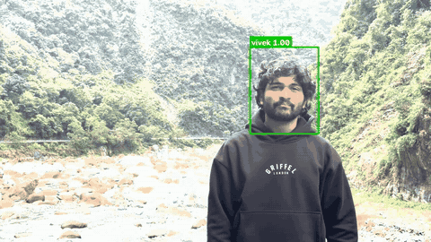
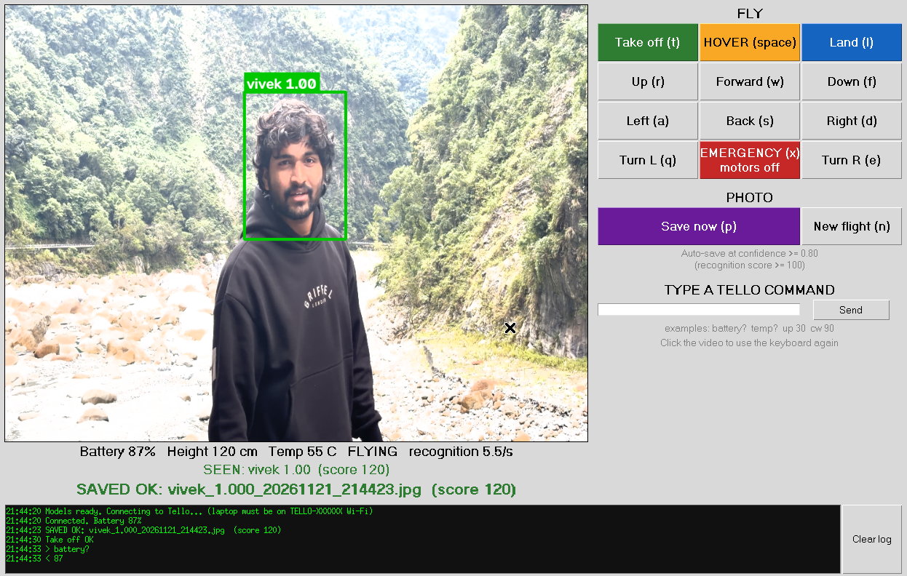
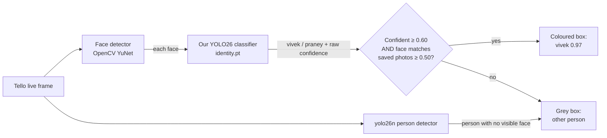
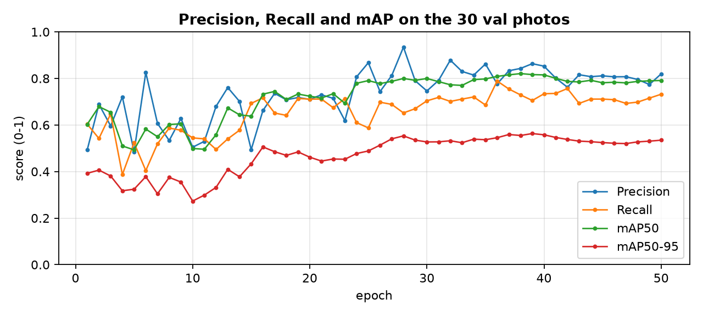

# UAV: Tello Drone + Live Face Recognition (YOLO26)


Fly a DJI Tello from a laptop **using only its live camera**, recognise which team member is
standing at the end of the route, and save a photo with **name + box + raw confidence**.
Built for the CCU UAV course practical exam. Also contains the course's YOLO26 training work.

<p align="center">
  <br>
  <em>Our recogniser on a test video: a box on the face, the name, and the model's raw confidence.</em>
</p>

---

## Quick start (Windows)

| Step | What to do |
|---|---|
| **1. Install** (once per laptop, normal internet) | Double-click **`setup.bat`**. It creates one venv (`.venv2`) with everything and ends with **ALL GOOD**. |
| **2. Connect** | Turn the Tello on → join the Wi-Fi **`TELLO-XXXXXX`** (no internet on it, that's normal). |
| **3. Fly + recognise** | `.venv2\Scripts\python.exe exam\flight_console.py` → click the video once → fly. |

Full step-by-step guide (photos, training, exam day, hand-in): **[exam/FLOW.md](exam/FLOW.md)**

---

## The flight console

<p align="center">
  
</p>

One window with everything:

- **Left:** live Tello video. Every face gets a box: `vivek 0.97` / `praney 0.95` / `other person`.
- **Below the video:** battery, height and temperature, plus a **SEEN** line with the exam score (confidence% + 20).
- **Right:** fly buttons, photo buttons, and a box to type Tello commands (`battery?`, `up 30`, `cw 90`).
- **Bottom:** a log of everything that happened.

| Key | Action | Key | Action |
|---|---|---|---|
| `t` | take off | `l` | land |
| hold `w` `s` | forward / back | hold `a` `d` | left / right |
| hold `r` `f` | up / down | hold `q` `e` | turn left / right |
| `space` | hover | `x` | **EMERGENCY** (motors off) |
| `p` | save photo now | `n` | new flight (allow a new auto-save) |

Let go of a key and the drone hovers.

**Auto-save:** when the same member is seen 3 times in a row with confidence **≥ 0.80**
(exam score ≥ 100), it keeps the clearest frame for 1 second and saves it to `exam/exam_photos/`.
It then re-opens the file to check it saved correctly and shows **SAVED OK**.
The confidence is always the model's **raw** output, never scaled or fixed (exam rule).

---

## How the recognition works



1. **Find faces.** OpenCV's YuNet face detector finds every face in the frame.
2. **Name each face.** Our **YOLO26 classifier** is trained on our own photos. It looks at the face, hair and glasses and says **vivek / praney / other**, with a confidence. That confidence is the number shown.
3. **Double check.** OpenCV's SFace face recogniser compares the face with that member's saved photos. If it doesn't match well enough, the box says **other person**. This stops strangers from getting a member's name.
4. **Faces we can't see.** `yolo26n.pt` finds whole people. Anyone whose face isn't visible gets a grey **other person** box.

**Why faces and not the whole body?** Our first model looked at the upper body and learned
"light-blue hoodie = praney". It called a classmate in a blue hoodie "praney 1.00". Face crops fixed that.

### Results (21 Nov)

| Test | Result |
|---|---|
| Test photos (never trained on) | praney **30/30**, vivek **49/57**, **0 wrong names** (misses = dark or turned-away faces → "other person") |
| Exam-like video (one person facing the camera) | **vivek 1.00 in 361 of 367 frames** |
| Videos with classmates (car, group selfies) | classmates → **other person**; members named when their face is visible |
| Held-out face crops (classifier only) | **99.4 %** accuracy |

---

## Train it on your own photos

All commands are run from the UAV folder. More detail is in [FLOW.md §3](exam/FLOW.md).

```
.venv2\Scripts\python.exe exam\convert_photos.py          # A. phone HEIC/JPG -> upright JPG
.venv2\Scripts\python.exe exam\build_identity_dataset.py  # B. face crops + face fingerprints
.venv2\Scripts\python.exe exam\train_identity.py          # C. train YOLO26 classifier (~15 min CPU)
.venv2\Scripts\python.exe exam\test_identity.py           # D. accuracy on the Test photos
.venv2\Scripts\python.exe exam\identify.py my_video.mp4   # E. labelled video in exam\identify_results\
```

Photo folders: `exam\dataset_raw\Train\<name>\`, `exam\dataset_raw\Test\<name>\`, and `exam\dataset_raw\background\` (the classroom without you).
Photos are not uploaded to GitHub, so copy them between laptops yourself.

---

## Project layout

```
UAV/
├── setup.bat                  one-click install (creates .venv2) + check
├── requirements.txt           every package the laptop needs
├── yolo26n.pt                 pretrained YOLO26 (finds people)
├── docs/                      pictures for this README
├── exam/                      ── drone exam ──
│   ├── flight_console.py      ★ fly + live recognition + auto-save (use in the exam)
│   ├── identify.py            the recogniser (also labels videos / photos)
│   ├── exam.py                backup: simple OpenCV window, same recognition
│   ├── control_panel.py       fly + take training photos with the Tello
│   ├── check_setup.py         "is this laptop ready?" (no drone needed)
│   ├── convert_photos.py / build_identity_dataset.py / train_identity.py / test_identity.py
│   ├── make_submission.py     zip code + models + exam photos to hand in
│   ├── models/                identity.pt, face_detector.onnx, face_recognizer.onnx, face_gallery.npz
│   └── FLOW.md                full step-by-step guide + exam rules + oral-check notes
└── (YOLO course)              main.py, demo.py, train.py, predict_mine.py, chair-table/, report.pdf …
```

---

## Exam rules in one minute

- **Roles:** pilot (back to the drone, watches only the laptop), target (stands in the taped box), safety observer (can call STOP).
- **Route:** take off → fly the U-shaped route around the tables → reach the target.
- **Timing:** the timer stops when the photo is **saved and opens**.
- **Score:** 50 % time rank (fastest team 100 … slowest 80) + 50 % recognition (**confidence% + 20**, max 120). Total max 110.
- **0 points for that flight:** hitting a person, crashing, leaving the area, the wrong name, or no saved photo.

Details are in [FLOW.md](exam/FLOW.md).

---

## Troubleshooting

| Problem | Fix |
|---|---|
| `Access is denied` / `This app can't run on your PC` | `.venv2` got damaged. Run `setup.bat` again, or `py -m venv --upgrade .venv2` |
| `Did not receive a state packet` | Normal on the first try. Run again |
| `Aborting command 'command'` | The laptop left the Tello Wi-Fi or the drone is off. Restart the drone and reconnect |
| No video | Allow `python.exe` in Windows Firewall (Private + Public) |
| Keys do nothing | Click the video in the console once (the window needs focus) |
| Name shows but no auto-save | Confidence is below 0.80 (orange SEEN line). Get closer, at face height, hold steady, or press `p` |
| Drone hot (> 80 °C) | Turn it off for 10 minutes |

---

## YOLO26 course work (Nov 10 assignment)

Trained YOLO26 on our own **chair / table** dataset (`chair-table/`, 2 classes, 120 train + 30 val photos, 50 epochs). Final mAP50 ≈ 0.79 on the val photos → `report.pdf`.

```
.venv2\Scripts\python.exe train.py          # train   -> runs/detect/train
.venv2\Scripts\python.exe predict_mine.py   # test the trained model on a new photo
.venv2\Scripts\python.exe make_report.py    # build report.pdf from the real results
```

<p align="center"></p>

Other helpers: `demo.py` (first YOLO26 detection), `video_demo.py`, `extract_frames.py`, `auto_label.py`,
`split_dataset.py`, `main.py` (fly the Tello with single-key commands, 30 cm per step).
